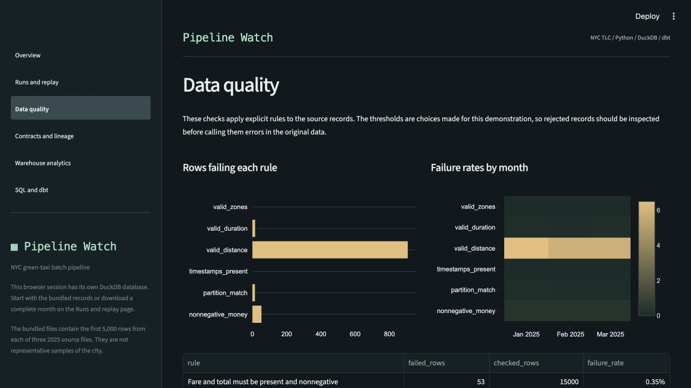

# Pipeline Watch



Pipeline Watch ingests NYC green-taxi records into DuckDB and records what happened
to each batch. Its Streamlit pages inspect publications, rejected rows, schemas,
query plans and the resulting analytics tables.

## Run locally

Python 3.11 is the tested runtime.

```bash
python -m venv .venv
source .venv/bin/activate
python -m pip install -r requirements.txt
python -m streamlit run app.py
```

Each browser session gets an isolated warehouse. On its first visit, the app loads
three bundled January-March 2025 source extracts, with 5,000 rows per month in
original file order. These extracts are not representative samples of citywide
trips. Their provenance, full-file counts and checksums are recorded in
`data/bundled/manifest.json`. Startup needs no API key or download.

## Pages

- **Overview:** current row counts and conservation, acceptance by month,
  processing times, publications, database size and retained bronze files.
- **Runs and replay:** source selection, real ingestion, throughput/rejection
  charts, comparison of repeated publications and a missing-column failure drill.
- **Data quality:** rule failure counts, month/rule heatmap, accepted-versus-rejected
  distributions and inspectable rejection records.
- **Contracts and lineage:** dependencies, required fields, current source schemas,
  drift history, source checksums and provenance.
- **Warehouse analytics:** date coverage, pickup-hour heatmap, borough comparisons,
  distance/duration scatter, trip-total quantiles and pickup-zone concentration.
- **SQL and dbt:** a read-only query runner, physical query plans, gold SQL and a
  real dbt build against the session warehouse.

These are separate Streamlit pages, each with its own URL. Computation is limited
to the page being viewed.

## Ingestion and replay

```bash
python pipeline.py demo
python pipeline.py run --month 2025-03 --mode live
python pipeline.py dbt
```

The CLI defaults to `runtime/warehouse.duckdb`. Use `--database /absolute/path/db.duckdb`
for a persistent local path. `demo --mode live` downloads all three complete months
from [NYC TLC](https://www.nyc.gov/site/tlc/about/tlc-trip-record-data.page).

Bronze stores immutable Parquet copies addressed by SHA-256, including failed
schema-drill inputs. Each attempt records its source URL, checksum, schema changes,
row counts, timestamps and error. Identical source files reuse their bronze copy.

Validation checks required fields, timestamp presence, positive duration up to
24 hours, partition month, distance above zero and at most 250 miles, finite
nonnegative fare/total, and valid lookup zone IDs. These bounds are explicit demo
policies. Malformed or outlying values deserve inspection; rejection does not
prove the original record is factually wrong.

Silver uses a hash of canonical core values, with a primary key on month and row
hash. A successful run replaces one month inside a transaction. Missing required
columns or zero valid rows fail before replacement. Additional fields and type
changes are recorded as drift. Gold aggregates accepted trips by day and zone,
using the same `zone_daily.sql` file in Python publication and dbt.

## Reading the analytics

Conservation counts only the current publication of each month:

```
source rows = unique accepted rows + rejected rows + valid duplicate copies
```

Quality rules can overlap, while quarantine counts each rejected source row once.
Failure matrices cover all current source records. Rejection profiling is capped
at 10,000 rows; distribution charts disclose their sample limits and percentile
trimming. Warehouse charts use accepted records and report their date coverage.

Processing time excludes the preceding download and database initialisation.
Three small batches give little evidence about production throughput. Physical
plans describe operators and estimates; EXPLAIN is not a timing measurement.

The SQL runner permits one SELECT, disables external file/network access, and
caps output at 500 rows. The EXPLAIN path applies the same result-cap wrapper.
The dbt checks cover required values and duplicate identities; they do not establish
that all accepted trips are correct in the real world.

## Verify and deploy

```bash
python -m unittest test_pipeline.py
python pipeline.py demo
python pipeline.py dbt
```

Tests cover replay, quarantine, row conservation, failed/changed partitions,
read-only query restrictions, current-publication analytics, rejection profiling,
schema reports, all six pages, query results and EXPLAIN. GitHub Actions also builds
the sample warehouse and runs dbt.

On Streamlit Community Cloud, choose `main`, `app.py`, and Python 3.11. Host filesystem
state may be temporary; durable operation needs a persistent disk and a shared-state
design. This app has no production scheduler, authentication or multi-writer
warehouse. `render.yaml` provides an optional paid hosting configuration without
provisioning a service. Runtime data and dbt artifacts are ignored by Git.

Code is MIT-licensed. Public trip records and the zone lookup retain their upstream
provenance and terms. TLC notes that vendor-supplied records may be incomplete or
inaccurate.
